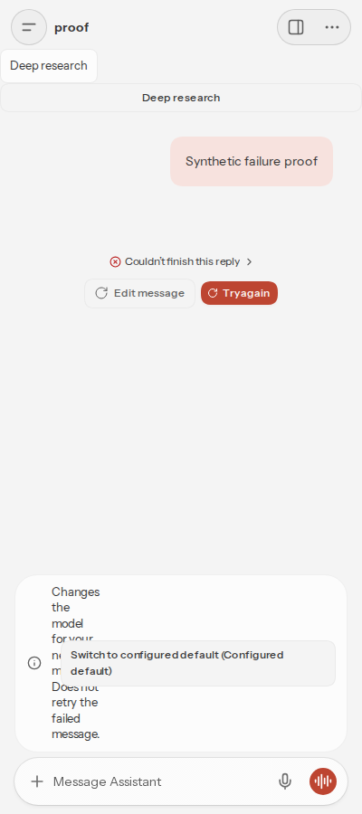
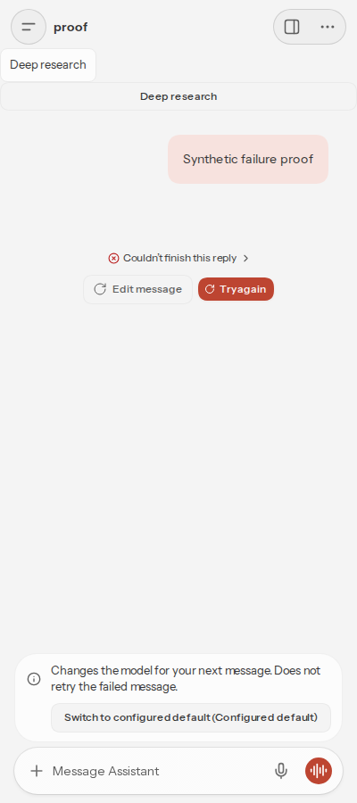

# PR 193672 mobile recovery repair

Head: `4fc84cdd0cfd0cc915bf4285cbf7e5bc07060a0c`

400 px viewport: help width grows from 0 to 314 px. Action starts 10 px below help; notice scrollWidth/clientWidth both 366 px. Browser regression includes a long unbroken model name and asserts help width, action placement, containment, no horizontal overflow, and reachable switch.

Real isolated Gateway, shipped UI. Failed synthetic provider call; no live service used. The local fixture endpoint was blocked by network policy, producing a real failed chat. Explicit switching, stale confirmation rejection, and no message replay passed. PNGs inspected; ancillary metadata removed. Desktop CSS is unchanged above 640 px and the fresh desktop capture was inspected locally.

